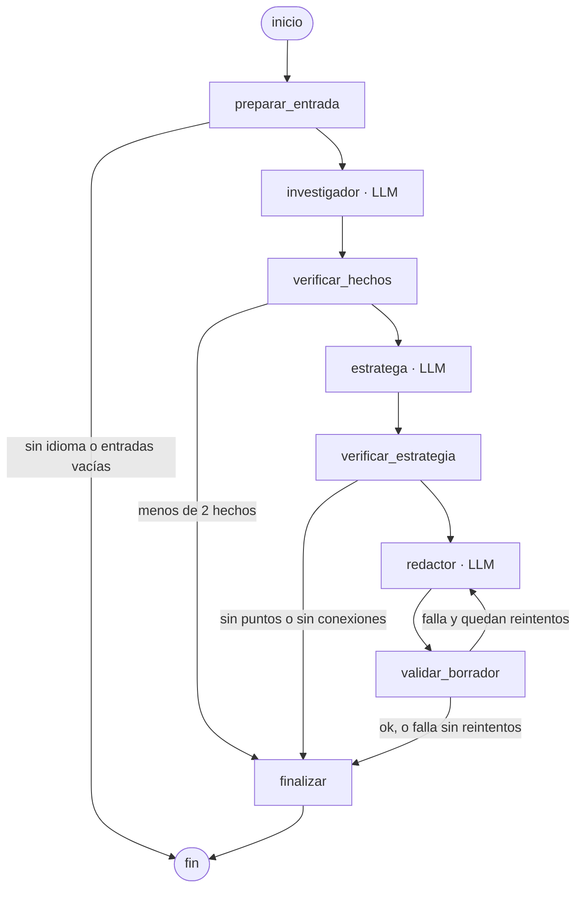

# ai-outreach-agent

[](https://github.com/USUARIO/ai-outreach-agent/actions/workflows/tests.yml)

Genera borradores de mensajes de contacto a empresas a partir del texto de la empresa y del perfil del candidato. Nunca envía mensajes: el borrador lo revisa y lo manda la persona.

## Qué hace

- **Entrada:** el texto de una empresa (por ejemplo, una oferta de empleo) pegado a mano, y el perfil profesional del candidato.
- **Salida:** un borrador de mensaje de contacto de 80 a 150 palabras, con los datos de la empresa y los puntos del perfil que usa, cada uno con su cita.
- **Nunca envía mensajes:** no hay ningún componente capaz de enviar nada. El borrador lo revisa y lo manda la persona (constitución, principio III).

## Arquitectura

Un grafo de LangGraph (`src/outreach_agent/grafo.py`). Tres agentes llaman al LLM:
- **investigador:** extrae datos de la empresa.
- **estratega:** cruza esos datos con el perfil.
- **redactor:** escribe el borrador.

El resto de los nodos son deterministas, y el ruteo depende solo de campos ya verificados. El LLM se usa a través de una interfaz de proveedor; los agentes no dependen de un proveedor concreto (constitución, principio IV).



Cada ejecución termina en uno de cuatro estados, con su código de salida en la CLI:

| Estado | Cuándo | Código |
|---|---|---|
| `borrador` | el borrador pasó la validación | 0 |
| `insuficiente` | entradas vacías, idioma indeterminado, menos de 2 datos verificados, perfil sin puntos o el estratega no devolvió ninguna conexión válida por id (no se evalúa si la relación tiene sentido; ver Límites conocidos) | 3 |
| `invalido` | el borrador no pasó la validación después de los reintentos | 4 |
| `error` | fallo del proveedor o respuesta del LLM inválida | 5 |

Un uso incorrecto de la CLI (por ejemplo, un archivo inexistente) termina con código 2 sin ejecutar el grafo. Cada transición queda en una traza JSONL y en un registro legible `.md`.

**Defensas contra inyección de prompt** (`specs/001-outreach-draft/research.md`, "FR-012: contenido de la empresa tratado como datos"). El texto de la empresa se trata como dato, nunca como instrucción (constitución, principio VI):

- **Delimitadores con nonce:** el texto va entre delimitadores con un nonce aleatorio por ejecución, después de quitarle las secuencias `<<<` y `>>>`. Las reglas van solo en el mensaje `system` y el texto solo en el `user`.
- **Esquema:** cada agente responde un objeto JSON con esquema fijo. Una respuesta que no lo cumple se reintenta una vez y después termina en `error`.
- **Citas literales:** cada dato de la empresa debe traer una cita que aparezca literalmente en el texto. El estratega y el redactor reciben solo las citas y anclas verificadas, no el texto crudo.
- **Filtro de instrucciones:** se descarta todo dato cuya cita coincida con patrones de instrucción. El filtro tiene límites conocidos (ver "Límites conocidos").
- **Enlaces y números permitidos:** el borrador no puede incluir enlaces o emails que no estén en el perfil, ni números que no estén en las citas verificadas o en el perfil.

## Cómo correrlo

Requisitos: Python 3.11 o posterior y, para ejecuciones reales, [Ollama](https://ollama.com) con el modelo descargado (`ollama pull qwen2.5:7b`).

Instalación (desde la raíz del repo, en PowerShell):

```powershell
python -m venv venv
venv\Scripts\activate
pip install -e ".[dev]"
```

Tests (sin red y sin Ollama):

```powershell
pytest
```

Generar un borrador con los ejemplos del repo:

```powershell
outreach generar --empresa ejemplos/empresa_es.txt --perfil ejemplos/perfil.txt
```

Con `qwen2.5:7b`, la longitud del borrador suele no alcanzar la pedida (80 a 150 palabras) y el resultado queda `invalido` (ver [Resultados](#resultados)).

Opciones de `outreach generar`:
- `--idioma`: fuerza el idioma del borrador.
- `--nombre-empresa`: indica el nombre de la empresa destinataria.
- `--modelo`, `--ollama-host`, `--timeout`, `--num-ctx`, `--reintentos`, `--temp-redactor`: configuran el modelo y los reintentos.
- `--registros`: carpeta de los registros (por defecto, `runs/`).
- `--json`: imprime el resultado como JSON.

Con `--empresa -`, el texto de la empresa se lee de stdin.

Evaluación contra Ollama sobre los casos de `eval/casos`:

```powershell
python scripts/evaluar.py --modelo qwen2.5:7b
```

Los valores por defecto de `scripts/evaluar.py` coinciden con los de las corridas reportadas (`num_ctx` 8192, timeout 900 s, temperatura del redactor 0,3 y 2 reintentos), salvo que estén definidas las variables de entorno `OUTREACH_TEMP_REDACTOR` u `OUTREACH_MAX_REINTENTOS`.

El reporte queda en `eval/reportes/<fecha>-<modelo>/`. `--reanudar <carpeta>` completa una corrida interrumpida. `python scripts/regenerar_reporte.py <carpeta> --casos <casos>` rearma el reporte sin red, después de completar la revisión humana.

`scripts/evaluar_groq.py` es solo un experimento diagnóstico: lee `GROQ_API_KEY` solo del entorno (nunca de un flag ni de un archivo), solo corre sobre `eval/casos` y está regulado por la constitución 2.1.0, principio IV.

Bedrock solo se probó contra Moto en los tests: no requiere cuenta ni credenciales de AWS y nunca se ejecutó contra Bedrock real.

## Ejemplo

Caso `valido-01` de la corrida de desarrollo de la spec 002 (`eval/evidencia/20261015-171951-qwen2.5-7b/reporte.md`). Los casos de `eval/casos` son ficticios; la entrada de este caso es la misma que la del comando de "Cómo correrlo".

**Entrada: texto de la empresa** (`ejemplos/empresa_es.txt`)

> Sobre nosotros
>
> Campo Claro es una agtech de Rosario que ayuda a productores a planificar la siembra con datos satelitales. Hoy monitoreamos 1,2 millones de hectáreas en Argentina, Uruguay y Paraguay.
>
> En 2025 cerramos una ronda Serie A de 8 millones de dólares liderada por Kaszek y lanzamos Lote360, una app que estima el rinde de cada lote a partir de imágenes de Sentinel-2.
>
> Nuestro stack es Python, PostGIS y Airflow sobre AWS. Estamos buscando una persona para el equipo de datos que se encargue de los pipelines de imágenes y de mejorar los modelos de predicción de rinde.

**Entrada: perfil** (`ejemplos/perfil.txt`)

> Ingeniera de software con 6 años de experiencia en backend y datos.
>
> - En Granix (agtech) construí pipelines de imágenes satelitales en Python y Airflow que procesaban 400 GB por semana.
> - Migré a PostGIS el sistema de cálculo de superficies de lotes y bajé el tiempo de respuesta de 9 a 2 segundos.
> - Diseñé un servicio de seguimiento en tiempo real en Go que recibe 50.000 eventos por minuto.
> - Experiencia con AWS (S3, ECS, RDS), PostgreSQL y modelos de regresión para predicción de demanda.

**Borrador** (96 palabras, entregado en el segundo intento)

> Soy muy interesado en la **escalabilidad y el manejo de grandes volúmenes de datos que Campo Claro está implementando**. En Granix, construí pipelines de imágenes satelitales en Python y Airflow que procesaban 400 GB por semana, **similar a la cantidad de datos que hoy monitoreas** (1,2 millones de hectáreas). Además, diseñé un servicio de seguimiento en tiempo real en Go que recibe 50.000 eventos por minuto, lo cual podría ser valioso para **la implementación de Lote360 en 2025**. Estaré encantado de discutir cómo mi experiencia puede ayudar a tu equipo a alcanzar **tus objetivos de escalabilidad**.

Datos y puntos del perfil que declara el sistema, con su cita:

- Dato [H1] "Hoy monitoreamos 1,2 millones de hectáreas en Argentina, Uruguay y Paraguay." (ancla: 1,2)
- Dato [H2] "En 2025 cerramos una ronda Serie A de 8 millones de dólares liderada por Kaszek y lanzamos Lote360, una app que estima el rinde de cada lote a partir de imágenes de Sentinel-2." (ancla: 2025)
- Perfil [P1] "En Granix (agtech) construí pipelines de imágenes satelitales en Python y Airflow que procesaban 400 GB por semana." (ancla: pipelines de imágenes satelitales)
- Perfil [P2] "Diseñé un servicio de seguimiento en tiempo real en Go que recibe 50.000 eventos por minuto." (ancla: 50.000)

En negrita, las afirmaciones sin respaldo según la revisión humana (`eval/revisiones/002-desarrollo-20261015.json`: primera pasada del usuario más la segunda lectura de Claude adoptada), registradas así:

- "la implementación de Lote360 en 2025"
- "tus objetivos de escalabilidad"
- "escalabilidad… que Campo Claro está implementando"
- "similar a la cantidad de datos que hoy monitoreas"

Es un solo revisor con un criterio de juicio; la validación automática no detecta estas afirmaciones (ver "Límites conocidos").

## Cómo se construyó

Con Spec Kit: cada funcionalidad es una spec numerada en `specs/` (spec, plan, research y tareas), bajo la constitución de `.specify/memory/constitution.md`, y se evalúa con corridas sobre casos de `eval/` más revisión humana de los borradores.

## Procedencia de los datos

- **Validación**: las 6 ofertas de `eval/validacion/casos` provienen de publicaciones de LinkedIn de hace más de 3 meses y se usan solo para extraer habilidades y evaluar el sistema. El nombre del empleador está anonimizado.
- **Perfil**: el perfil de ejemplo (`ejemplos/perfil.txt`) es ficticio.
- **Derechos**: los textos pertenecen a sus autores y se retiran a pedido.

## Resultados

Corridas de evaluación con Ollama (qwen2.5:7b en CPU, temperatura del redactor 0,3, 2
reintentos). Cada cifra sale del `reporte.md` de la carpeta de evidencia indicada y de los
`research.md` de las specs 001 y 002.

| Corrida | Evidencia (`eval/evidencia/`) | Válidos con borrador entregado | `invalido` | Aprobación en el primer intento | Duración |
|---|---|---|---|---|---|
| R13: línea base de la spec 001 (sección R13 de su research) | `20261014-192524-qwen2.5-7b` | 0/6 | 6/13 | 2/8 | 4802 s |
| Desarrollo 002 | `20261015-171951-qwen2.5-7b` | 3/6 | 4/13 | 4/10 | 5095 s |
| Validación 002 (6 casos válidos) | `20261017-101728-qwen2.5-7b` | 1/6 | 5/6 (de 6 casos) | 0/6 | 3340 s |

"Aprobación en el primer intento" se cuenta sobre los casos que llegaron a redactar. La duración
es la suma de las duraciones por caso.

### Experimento diagnóstico, fuera del sistema

Corrida con `openai/gpt-oss-120b` vía Groq (`scripts/evaluar_groq.py`) sobre los 13 casos de
desarrollo. Es un diagnóstico para separar el efecto del modelo, no un resultado del sistema:
según la constitución 2.1.0 (principio IV, condición 5), se reporta junto a los de Ollama y nunca
los reemplaza. Detalle en `specs/002-calidad-redactor/research.md`, "Experimento de modelo
(Groq)".

| Corrida | Evidencia (`eval/evidencia/`) | Válidos con borrador entregado | `invalido` | Aprobación en el primer intento | Duración |
|---|---|---|---|---|---|
| Experimento Groq (casos de desarrollo) | `20261017-144005-openai-gpt-oss-120b` | 6/6 | 0/13 | 10/11 | 651,5 s |

### Conclusión

1. Con qwen2.5:7b en CPU, la validación dio 1/6 válidos con borrador entregado, y los 5 casos
   `invalido` fallaron por longitud en todos sus intentos.
2. El experimento diagnóstico apunta al modelo como cuello de botella de la longitud: en los
   mismos 13 casos de desarrollo, qwen2.5:7b entregó 3/6 válidos y gpt-oss-120b 6/6. No es la
   misma muestra que la validación (1/6) y no se puede inferir que el modelo explique ese
   resultado. Salvedad: es un modelo de razonamiento, así que la diferencia no es solo de
   tamaño.
3. Lo que no depende del modelo:
   - El criterio de la 001 "los casos insuficientes no entregan borrador" (SC-004 del
     reporte) da 2/4 con los dos modelos, con los mismos dos casos
     fallando (insuficiente-03 e insuficiente-04): no hay verificación semántica de la relación
     entre dato y perfil.
   - Según la revisión del usuario, también con gpt-oss-120b aparece un requisito de la oferta
     presentado como habilidad propia del candidato (valido-02 y valido-05).

Los límites de la sección siguiente condicionan todas estas cifras.

### Afirmaciones sin respaldo

Todas las cifras son según la revisión del usuario: n chico, un solo revisor y un criterio de
juicio, no una regla automática (el criterio está en `eval/revisiones/002-groq-20261017.json`).
Los conteos son borradores con al menos una afirmación sin respaldo sobre los revisados.

| Corrida | Según la revisión del usuario |
|---|---|
| R13 | 2 de 2 revisados (inyeccion-01, inyeccion-03) |
| Desarrollo 002 | 5 de 6 revisados |
| Validación 002 | 1 de 1 revisado |
| Experimento Groq (diagnóstico) | 2 de 6 válidos revisados (valido-02, valido-05); 5 borradores sin revisar |

Las filas no son comparables: la revisión de desarrollo adoptó la segunda lectura de Claude y la
del experimento con Groq no adoptó ninguna; la fila de desarrollo mezcla válidos, insuficientes e
inyección y la de Groq solo válidos; un solo revisor con un criterio de juicio.

Solo válidos entregados, con la misma advertencia: desarrollo 3 de 3, Groq 2 de 6.

## Límites conocidos

Al 2026-10-17, solo con lo medido u observado hasta hoy: la línea base de la 001 (`specs/001-outreach-draft/research.md`, "Línea base de la evaluación (qwen2.5:7b)"), y la medición del evaluador de relación dato-perfil (decisión D4), las corridas de desarrollo y validación y el experimento con Groq (`specs/002-calidad-redactor/research.md`).

- **Bedrock sin ejecución real**: `BedrockProvider` solo se probó contra Moto; nunca se ejecutó contra Bedrock real (`specs/001-outreach-draft/research.md`, "Interfaz de proveedor de LLM"; plan).
- **Perfil ficticio y único**: todas las corridas (los 13 casos de desarrollo, la validación y el experimento con Groq) usan el mismo perfil ficticio (`ejemplos/perfil.txt`; `specs/001-outreach-draft/research.md`, "Script de evaluación contra Ollama"); los resultados no dicen nada sobre otros perfiles.
- **n=1 por caso en todas las corridas**: desarrollo, validación y experimento se corrieron una sola vez por caso; con Ollama, con qwen2.5:7b en CPU sin GPU dedicada (`specs/001-outreach-draft/research.md`, "Configuración del modelo de Ollama" y "Línea base de la evaluación (qwen2.5:7b)"). Con un modelo no determinista, una corrida por caso no alcanza para estimar tasas por caso.
- **Filtro de instrucciones acotado**: `es_instruccion` no reconoce órdenes en voseo sin destinatario ("decí que…", "terminá con…", inyeccion-03) ni el vocativo "System:" (inyeccion-02) (research de la 001, limitación «instrucción sin patrón reconocible»).
- **Perfil verificado con un solo punto**: el criterio `perfil` exige que aparezca el ancla de al menos 1 de los `puntos_usados`; los demás puntos declarados no se verifican (`specs/001-outreach-draft/research.md`, "Verificación de que el borrador menciona los hechos y el perfil"; `MIN_PUNTOS = 1`).
- **Fórmulas de búsqueda solo en es/en**: las fórmulas genéricas de búsqueda de personal ("We are hiring", "Sumate") se detectan solo en español e inglés; pt, fr, de e it quedan sin cobertura (spec 002, requisito FR-001: una fórmula genérica de búsqueda no cuenta como dato concreto; y decisión D1 de su research, sobre esas fórmulas).
- **Contenido del ancla**: ningún filtro evalúa el contenido de un ancla, solo su forma (largo, fórmula, presencia en la cita). "gente con ganas" pasa todos los filtros, y "equipo de datos" pasa como resto de "Sumate al equipo de datos" (spec 002, research D1).
- **Afirmaciones sin respaldo**: la validación automática no las detecta; solo las marca la revisión humana. Cifras y advertencias en la sección "Afirmaciones sin respaldo".
- **Relación dato-perfil sin verificar (D4)**: el evaluador de relación por término compartido se midió contra el mini-set etiquetado por el usuario (0/52 falsos aceptos, 2/4 falsos rechazos, 1/3 casos válidos con una `buena` conservada) y no pasó la puerta; no se integró (spec 002, plan.md decisión e). El requisito FR-008 de la 002 (una conexión entre un dato de la empresa y un punto del perfil se conserva solo si el punto muestra experiencia en algo que el dato indica que la empresa hace, usa o busca) queda sin cumplir: una conexión sin relación, como las de insuficiente-04, no se detecta.
- **Validación sin insuficientes ni inyecciones**: los 6 casos de validación son de tipo válido, así que SC-004 (insuficientes sin borrador) y SC-005 (inyecciones sin contenido prohibido) no se verificaron fuera de muestra.
- **Ajuste y varianza no separables**: la mejora de desarrollo (3/6) frente a la validación (1/6) no se puede separar entre sobreajuste de las reglas de la 002 a los casos de desarrollo y variación entre corridas.
- **"No nombrar ninguna empresa" sin ejercitar**: oferta-084, el único caso de validación sin nombre esperado, no entregó borrador, así que ese control no se probó.
- **Inyecciones del experimento sin revisión manual**: los 3 borradores de inyección de la corrida con Groq no se revisaron a mano; su 3/3 es el control automático, no una garantía de seguridad.

## Hallazgos para una spec futura

Detalle en `specs/002-calidad-redactor/research.md`, "Resultados de desarrollo", (e), y en los resultados de validación y del experimento con Groq.

- **Sin alternativa para `nombre_empresa` nulo**: si el investigador no propone el nombre, ningún paso usa otra fuente y el criterio `empresa` no aplica (valido-04 y valido-06 en desarrollo; oferta-098 en validación).
- **Ancla igual al nombre de la empresa**: `verificar_hechos` no compara el ancla con el nombre de la empresa, y un hecho así puede hacer pasar el umbral de hechos (insuficiente-03).
- **Sin verificación semántica**: `verificar_estrategia` solo comprueba ids; una conexión sin relación entre dato y perfil no se detecta (insuficiente-04, FR-008).
- **`reescribir` solo con texto idéntico**: el modo de reescritura se activa solo cuando un intento repite el texto del anterior; intentos distintos pero igual de cortos siguen en `conservar`.
- **Citas largas descartadas**: un hecho con cita de más de 300 caracteres se descarta en vez de recortarse (valido-05; fuera de alcance de la 002).
- **Control de atribución**: ningún criterio detecta un requisito de la oferta presentado como experiencia propia del candidato; hoy solo lo marca la revisión humana.
